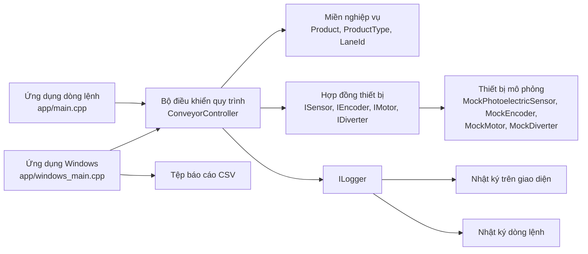
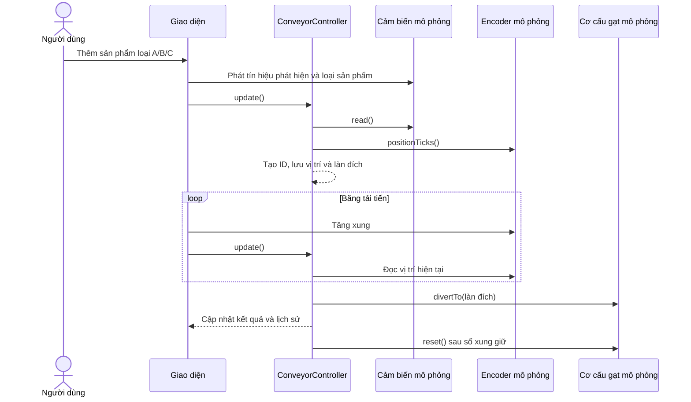

# Kiến trúc hệ thống

## 1. Mục đích và phạm vi

Smart Conveyor là chương trình desktop mô phỏng một dây chuyền phân loại sản phẩm theo loại. Người dùng có thể đưa sản phẩm mẫu vào cảm biến, chạy băng tải, quan sát sản phẩm tiến theo xung encoder, theo dõi cơ cấu gạt và xem kết quả từng làn. Ứng dụng Windows còn hỗ trợ chạy lô tự động và xuất lịch sử phân loại ra tệp CSV.

Bản hiện tại chạy bằng các thiết bị mô phỏng (`Mock*`). Đây chưa phải phần mềm điều khiển máy thật: chương trình chưa kết nối PLC, cảm biến, encoder hay cơ cấu chấp hành vật lý. Loại sản phẩm trong bản demo do người dùng chọn; chương trình không tự nhận dạng bằng camera, mã vạch hay cân.

## 2. Sơ đồ thành phần

Các mũi tên thể hiện quan hệ sử dụng: giao diện gọi bộ điều khiển; bộ điều khiển xử lý quy tắc phân loại thông qua các hợp đồng thiết bị; bản chạy hiện tại cung cấp các thiết bị mô phỏng để thực hiện những hợp đồng đó.

## 3. Các lớp và trách nhiệm

| Thành phần | Trách nhiệm |
|---|---|
| `src/domain/` | Định nghĩa dữ liệu sản phẩm, loại sản phẩm A/B/C/không xác định và làn đích 1/2/3/loại bỏ. Không phụ thuộc giao diện hay thiết bị. |
| `src/application/ConveyorController.*` | Điều phối quy trình: đọc cảm biến, tạo ID khi có cạnh phát hiện, lưu vị trí encoder, chọn làn, kích hoạt và trả cơ cấu gạt, ghi thống kê/lịch sử, xử lý lỗi. |
| `src/hal/interfaces/` | Các hợp đồng trừu tượng để bộ điều khiển làm việc với cảm biến, encoder, động cơ và cơ cấu gạt mà không gắn với một hãng phần cứng cụ thể. `IClock` hiện chưa được bộ điều khiển sử dụng. |
| `src/platform/simulation/` | Các thiết bị thay thế trên máy tính: cảm biến có thể phát hiện/không hợp lệ, encoder nhận xung, động cơ giữ trạng thái chạy/dừng, cơ cấu gạt giữ làn được chọn/trạng thái hoạt động. |
| `src/diagnostics/` | Hợp đồng ghi nhật ký và bộ ghi nhật ký cho ứng dụng dòng lệnh. Giao diện Windows có bộ ghi riêng để đưa thông báo vào cửa sổ. |
| `app/windows_main.cpp` | Giao diện thao tác Windows, điều khiển timer mô phỏng, hoạt ảnh băng tải/sản phẩm, chạy lô, hiển thị thống kê và xuất CSV. |
| `app/main.cpp` | Giao diện dòng lệnh để thêm sản phẩm, tiến encoder theo số xung, xem trạng thái/thống kê và tạo một số tình huống lỗi mô phỏng. |

## 4. Luồng xử lý một sản phẩm

1. Người dùng chọn loại sản phẩm rồi bấm **Thêm sản phẩm**, hoặc bắt đầu một lô tự động. Giao diện đặt loại sản phẩm vào cảm biến mô phỏng.
2. `ConveyorController::update()` đọc `SensorReading`. Khi tín hiệu chuyển từ không phát hiện sang phát hiện, bộ điều khiển tạo ID mới, lấy vị trí hiện tại của encoder và đưa sản phẩm vào danh sách đang chờ.
3. Bộ điều khiển ánh xạ loại sản phẩm: A → làn 1, B → làn 2, C → làn 3, không xác định → làn loại bỏ.
4. Mỗi xung encoder biểu thị băng tải đã tiến thêm một đơn vị mô phỏng. Khi vị trí hiện tại đạt vị trí phát hiện cộng khoảng cách đến cơ cấu gạt, bộ điều khiển ra lệnh chọn làn tương ứng, ghi kết quả và tăng bộ đếm.
5. Cơ cấu gạt mô phỏng được trả về trạng thái ban đầu sau số xung giữ đã cấu hình. Giao diện vẽ sản phẩm đi đến làn tương ứng để người dùng quan sát.

## 5. Quy tắc nghiệp vụ và trạng thái

### Ánh xạ loại sản phẩm

| Loại đọc từ cảm biến | Làn đích |
|---|---|
| A | Làn 1 |
| B | Làn 2 |
| C | Làn 3 |
| Không xác định | Loại bỏ |

### Trạng thái bộ điều khiển

- `IDLE`: băng tải đang dừng.
- `RUNNING`: bộ điều khiển đọc cảm biến và xử lý vị trí sản phẩm.
- `FAULT`: phát hiện dữ liệu cảm biến không hợp lệ hoặc encoder không tăng trong khi còn sản phẩm chờ và động cơ được báo đang chạy. Bộ điều khiển dừng động cơ mô phỏng và đưa cơ cấu gạt về trạng thái ban đầu.

Sau khi nguyên nhân lỗi cảm biến đã được xóa, có thể gọi khôi phục lỗi để khởi động lại. Bộ đếm lỗi tăng khi bộ điều khiển đi vào trạng thái lỗi. Các thống kê là dữ liệu trong bộ nhớ của phiên chạy hiện tại.

## 6. Thời gian và xung trong giao diện Windows

Giao diện Windows dùng timer khoảng 16 ms để cập nhật hoạt ảnh. Thời gian thực đã trôi qua được tích lũy để mô phỏng tốc độ 20 xung/giây; vì vậy mỗi lần vẽ lại màn hình không đồng nghĩa với một xung encoder. Một lô tự động đưa thêm một sản phẩm sau mỗi 40 xung, tương đương khoảng 2 giây ở tốc độ demo.

Khoảng cách mặc định từ điểm phát hiện đến cơ cấu gạt là 100 xung; thời gian giữ gạt mặc định là 10 xung. Đây là tham số của mô hình để minh họa luồng xử lý, không phải thông số đã hiệu chuẩn cho băng tải thực. Giao diện dòng lệnh không tự chạy theo thời gian: người dùng chủ động nhập lệnh `tien N` để tăng encoder N xung.

## 7. Dữ liệu kết quả

Bộ điều khiển duy trì:

- Danh sách sản phẩm đang chờ đến cơ cấu gạt.
- Số lượng đã phát hiện, số lượng vào từng làn và số lỗi.
- Lịch sử phân loại gồm ID, loại sản phẩm, làn đích, vị trí phát hiện và vị trí gạt.

Ứng dụng Windows có thể xuất lịch sử và thống kê của phiên hiện tại thành CSV. Tệp CSV không phải cơ sở dữ liệu và dữ liệu chưa được lưu tự động sau khi đóng ứng dụng.

## 8. Ranh giới giữa mô phỏng và máy thật

Các giao diện `ISensor`, `IEncoder`, `IMotor`, `IDiverter` tạo điểm thay thế thiết bị, nhưng chỉ thêm driver vào các giao diện này chưa đủ để triển khai dây chuyền thật. Cần xác định PLC/bộ điều khiển, giao thức truyền thông, kiểu tín hiệu điện, chiều quay và tốc độ động cơ, cấu hình encoder, thời gian đáp ứng cơ cấu gạt, đồng bộ hóa dữ liệu, dừng khẩn cấp và các liên động an toàn. Cần kiểm thử và hiệu chuẩn trên phần cứng trước khi vận hành.

Bản hiện tại không xác nhận sản phẩm vật lý đã thực sự vào làn: kết quả được ghi khi chương trình ra lệnh cho cơ cấu gạt mô phỏng. Muốn xác nhận đầu ra thật cần thêm cảm biến tại làn nhận và quy trình xử lý khi sản phẩm không tới đúng đích.

## 9. Hướng mở rộng

1. Tạo lớp driver cho PLC hoặc bộ điều khiển đã chọn, triển khai các hợp đồng thiết bị hiện có.
2. Thêm cấu hình thiết bị và đơn vị vật lý; chuyển đổi giữa xung, quãng đường và tốc độ theo thông số encoder/băng tải.
3. Bổ sung cảm biến nhận dạng sản phẩm nếu cần tự xác định loại thay vì chọn tay.
4. Thêm cảm biến xác nhận sản phẩm tại các làn, timeout và trạng thái phân loại thất bại.
5. Lưu cấu hình/lịch sử bền vững và bổ sung chẩn đoán kết nối thiết bị.
6. Thiết kế liên động, dừng khẩn cấp và kiểm thử an toàn phù hợp trước khi nối vào máy thật.
